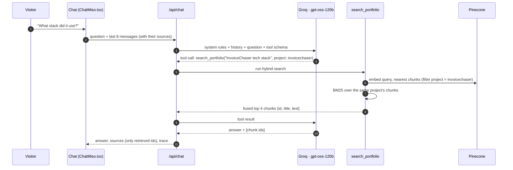

# chiranjeevthomas.com

Portfolio of Chiranjeev Thomas, senior full-stack engineer building agentic AI products. It holds case studies, writing, and **Miso**: a tool-calling RAG agent that answers recruiters' questions about the portfolio, cites where each answer came from, and shows its reasoning live in an agent trace.

Next.js 15 (App Router, TypeScript) on Netlify · Groq (`gpt-oss-120b`) for the agent · Pinecone integrated inference (`llama-text-embed-v2`) for semantic search · a local BM25 index for keywords.

<p align="center">
  
</p>

## Miso in 30 seconds

- **Agentic retrieval:** the LLM decides *whether* to search, *what* to search for (it rewrites vague or follow-up questions into standalone queries), and *where*: it can scope a search to a single project. Up to 3 searches per question.
- **Hybrid search:** every search runs a meaning search (Pinecone vector embeddings) and a keyword search (BM25), merged with reciprocal rank fusion.
- **Grounded answers:** the model may cite only chunk ids it actually retrieved. Fabricated citations are dropped before the answer reaches the visitor.
- **Always current:** every deploy re-syncs the vectors, re-embedding only the chunks whose text changed.
- **Degrades instead of breaking:** with no Pinecone it searches by keyword; with no LLM (or a Groq outage) it quotes the best passages; on a Groq rate limit it switches models.
- **Observable:** the agent trace beside the chat shows each tool call, the meaning and keyword matches with their scores, the merged ranking, and which sources the answer used.

## How a question is answered



**Conversation memory.** The server keeps no session state. Each request carries the last 8 messages (4 exchanges), and assistant turns include the titles of their sources. The system prompt tells the model to use that history to resolve follow-ups ("what stack did *it* use?" → InvoiceChaser), to rewrite them into standalone search queries, and to treat earlier answers as context, not as a source: every factual follow-up is searched again and cited. The history resets on reload or "new chat" ([components/chat/ChatMiso.tsx](components/chat/ChatMiso.tsx), [lib/agent.ts](lib/agent.ts)).

**While it works.** The chat card glows until the answer arrives, Miso chases a mouse across the pending bubble with a live status line and timer, and the agent trace fills in step by step ([components/chat/ChaseLoader.tsx](components/chat/ChaseLoader.tsx)).

## Chunking: one idea per chunk, never across projects

[`buildIndex()`](lib/search-index.ts) turns `content/` into 40 chunks (about 3,400 tokens in total):

| Source | Chunks |
| --- | --- |
| Each project (`content/projects/*.md`) | A summary chunk (title, status, type, summary, stack, links) plus one chunk per `##` section of the case study |
| Each blog post | One chunk per `##` section, titled "Post title: Section" |
| Each job (`experience.yaml`) | One chunk per role |
| Each skill group (`skills.yaml`) | One chunk with every skill and where it was used |
| All projects | One overview chunk: every project with its type, status and one-line summary, so list questions ("which full-stack projects?") see them all at once |
| Profile, contact, Miso | One chunk each |

**Why split on headings instead of fixed-size windows?** Fixed windows with overlap (for example LangChain's 500-character splitter) suit PDFs, where nothing marks where an idea ends. These files are written with `##` sections, and each section is already one idea ("Dynamic tool gating", "Every draft stops for approval"). Splitting there never cuts an idea in half, so overlap would only duplicate text and blur which section matched. Chunks run 14–184 words, far inside the embedding model's 2,048-token limit and small enough to stay on one topic. Each chunk is embedded as `Title. Text`, so a section called "The plan" still carries its project's name.

**Measured against the alternatives** (9 recruiter-style questions on live Pinecone, including two "list all" questions):

| Strategy | Right page in results | Coverage of list answers | Tokens sent to the LLM |
| --- | --- | --- | --- |
| **Sections + overview chunk (live)** | 8/9 | 0.89 | ~410 |
| Sections only | 8/9 | 0.82 | ~380 |
| One chunk per document | 8/9 | 0.76 | ~710 |
| Small-to-big (match sections, return whole projects) | 8/9 | 0.80 | ~1,150 |

Whole documents dilute each embedding and cost almost twice the tokens. Small-to-big costs three times as many for no gain. Returning 6 chunks instead of 4 added nothing once the overview chunk existed. The whole corpus would fit in one prompt, but Groq's free tier allows 8K tokens a minute, so sending ~400 retrieved tokens instead of ~3,400 is what lets several visitors chat at once. The one miss is a deliberately vague question; the agent recovers by rewriting it (see Decisions below).

**Every chunk belongs to exactly one file.** Each chunk records its `source` (`project:invoicechaser`, `post:langchain-tool-gating`, `experience`, `skills`, `profile`) and, when it is about a project, that project's slug. A post counts toward a project when its front matter says so (`project: invoicechaser`). Both fields are stored in Pinecone as metadata, which lets the agent run a search limited to one project. The evals check these boundaries on every run.

## Semantic search: matching meaning, not words

<p align="center">
  
</p>

The Pinecone index uses **integrated inference**: you send text, and Pinecone embeds it with its hosted `llama-text-embed-v2` model, both when chunks are upserted and when a question is searched. No embedding model runs in this app: the Netlify function only needs Pinecone's JavaScript client, with no model files or native binaries.

- Each chunk becomes a 1,024-number vector. Texts about the same idea land close together even when they share no words.
- A question is embedded the same way. Pinecone returns the chunks with the highest cosine similarity.
- Matches below **0.15** are dropped. Real matches on this index score about 0.2–0.35, while "What's his favourite pizza?" tops out at 0.12, so the chat says the topic isn't covered instead of quoting something unrelated. The floor doesn't apply to project-scoped searches.

Keyword search still matters: exact names ("InvoiceChaser") and phrasings like "where does he work *now*" (synonym → "Present") are where BM25 is strongest. So every search runs both.

## Merging the rankings: reciprocal rank fusion

<p align="center">
  
</p>

Each search returns its top 10. Every chunk then scores `Σ 1 / (60 + rank)` over the lists it appears in, and the top 4 go to the LLM ([`fuse()`](lib/search-index.ts)). Ranks are used instead of raw scores because cosine similarity and BM25 sit on different scales. Chunks both searches agree on rise; noise from a single list sinks.

## Keeping the vectors current

<p align="center">
  
</p>

- `npm run build` runs `npm run sync:vectors` first ([scripts/sync-vectors.ts](scripts/sync-vectors.ts)), so every Netlify deploy syncs the content.
- Each Pinecone record stores a hash of its text. New or edited chunks are upserted (Pinecone re-embeds them), deleted chunks are removed, and unchanged chunks cost no embedding tokens.
- If the sync fails, the build fails, so a deploy can't ship with stale vectors.
- In `npm run dev`, edits are synced on the next chat question, no restart needed.
- Namespaces keep environments apart: production deploys use `production`, deploy previews and branch deploys use `preview`, local runs use `local` ([lib/namespace.ts](lib/namespace.ts)).

## Guardrails and failure modes

| Situation | What happens |
| --- | --- |
| No `PINECONE_API_KEY`, or Pinecone is down | Keyword search answers alone; the trace says so |
| No `GROQ_API_KEY`, or Groq is down | Retrieval-only mode: the same hybrid search runs on the question as typed, and Miso quotes the best passages |
| Groq rate limit (free tier: 8K tokens/min per model) | Retries on `openai/gpt-oss-20b`, then waits the seconds Groq asks for and retries once |
| The model cites a chunk it didn't retrieve | The citation is dropped; only retrieved ids become sources |
| Off-topic request ("write a letter", "2 + 2") | A short, in-character redirect to questions about Chiranjeev's work, never a bare refusal |
| Prompt injection in a question or in content | The system prompt treats both as data, not instructions |
| Abuse | `CHAT_DAILY_LIMIT` questions per visitor IP per day (default 30, best effort) |

## Evals

`npm run eval:chat` ([scripts/eval-chat.ts](scripts/eval-chat.ts)) runs offline checks on every change, plus live checks when keys are present:

- **Retrieval:** each recruiter question must reach the expected page.
- **Chunk boundaries:** unique ids, one source per chunk, project-scoped search never leaks into another project.
- **Vector sync** (against an in-memory fake Pinecone): first sync uploads everything, a re-sync sends nothing, one edit plus one deletion sends exactly one upsert and one delete.
- **Fusion:** a chunk found only by meaning still makes the top 4; a Pinecone error falls back to keywords.
- **Agent loop** (mocked model): tool calls are traced, fabricated citations are dropped, Markdown is flattened, a 429 switches to the fallback model.
- **Live, with keys:** paraphrases that keyword search misses must be found by meaning, the project filter must hold, off-topic questions retrieve nothing, answers must be grounded, a follow-up's "it" must resolve to the earlier project, and off-topic or "why?" questions must get an explanation instead of a canned refusal.

## Decisions and what I measured

- **Local embeddings → Pinecone integrated inference.** I first ran `bge-small-en-v1.5` locally with transformers.js. It worked, but it needed a native ONNX runtime plus 34 MB of model files inside the Netlify function, and it ranked the hard paraphrases below the cut. Pinecone's hosted model is stronger, adds nothing to the bundle, and is free at this scale.
- **No reranker.** Pinecone's hosted `bge-reranker-v2-m3` scored nearly every candidate close to zero and moved "where does he work now?" to the contact chunk. It made results worse, and the free tier allows only 500 reranks a month.
- **Fusion weights don't matter here.** Weighting meaning 1.5–3× over keywords changed none of the test outcomes, so plain RRF stays.
- **Let the agent rewrite queries.** For "How does he keep tabs on what an AI is doing behind the scenes?", meaning search alone ranks the observability project 4th. The agent rewrites it to "monitor AI behind the scenes observability", scopes the search to that project, and answers from it.
- **Groq model.** Groq's free Developer plan no longer serves Llama 3.3 70B, so the agent uses `gpt-oss-120b`, which supports tool calling, with reasoning effort set to low.

## Run locally

```bash
npm install
cp .env.example .env.local   # add GROQ_API_KEY and PINECONE_API_KEY for the full chat
npm run dev                  # http://localhost:3000
```

In VS Code, open **Run and Debug** and start **Install & run dev server**.

Other scripts:

| Command | What it does |
| --- | --- |
| `npm run build` | Production build; fails on bad content (unknown tag, missing field) |
| `npm start` | Serves the production build |
| `npm run eval:chat` | Retrieval, vector-sync and agent-loop evals for the chat (adds live checks if `PINECONE_API_KEY` / `GROQ_API_KEY` are set) |
| `npm run sync:vectors` | Syncs the chat's content chunks to Pinecone (runs automatically before every build) |

## Environment variables

| Name | Required | Default | Purpose |
| --- | --- | --- | --- |
| `GROQ_API_KEY` | For live chat | — | Groq key. Without it the chat answers in retrieval-only mode. |
| `GROQ_MODEL` | No | `openai/gpt-oss-120b` | Model used by the agent (must support tool calling on your Groq plan) |
| `GROQ_FALLBACK_MODEL` | No | `openai/gpt-oss-20b` | Used when the main model hits its rate limit |
| `CHAT_DAILY_LIMIT` | No | `30` | Questions per visitor IP per day |
| `PINECONE_API_KEY` | For semantic search | — | Free Pinecone Starter key. Without it the chat searches by keyword only. |
| `PINECONE_INDEX` | No | `portfolio-chat` | Pinecone index name; created automatically on first sync |

Set them locally in `.env.local` (git-ignored) and on Netlify under **Site configuration → Environment variables**. Never commit a key.

## Editing content

Everything on the site comes from `content/`. The pages and the chat's search index read the same files, so the chat learns about a new project on the next deploy (or the next question, in dev).

| File | Controls |
| --- | --- |
| `content/site.yaml` | Name, intro, rotating headline words, socials, photo |
| `content/projects/*.md` | One file per project (card + case study page) |
| `content/posts/*.md` | Blog posts |
| `content/experience.yaml` | Experience cards |
| `content/skills.yaml` | Skills marquee, groups, "where I used it" |
| `content/tags.yaml` | The allowed tag vocabulary |

### Add a project

Create `content/projects/my-project.md`:

```md
---
title: My project — what it does
headline: One-line promise shown at the top of the case study
summary: Two sentences for the project card.
description: SEO description (about 150 characters).
status: Live            # Live · Open source · In progress · At Grabbit · SaaS product
date: 2026-11-01
order: 6                # lower shows first
types: [ai-engineering] # ai-engineering and/or full-stack
tags: [agents, rag]     # must exist in content/tags.yaml
stack: [Python, LangGraph, Groq]
product: false          # true puts it under the Products tab
caseStudy: true         # false hides "How it works"
links:
  demo: https://...
  github: https://github.com/...
media:                  # optional: put files in public/media/
  video: /media/my-project.mp4
  poster: /media/my-project.jpg
  alt: What the video shows
---

## The problem
...
```

Turn a GIF into a small MP4 for the card:

```bash
ffmpeg -i demo.gif -movflags faststart -pix_fmt yuv420p -vf "scale=trunc(iw/2)*2:trunc(ih/2)*2" public/media/my-project.mp4
ffmpeg -i demo.gif -vframes 1 public/media/my-project.jpg
```

Interactive diagrams: write `<!-- widget:name -->` on its own line in the Markdown and register the component in `components/widgets/Widgets.tsx`.

### Add a post

Create `content/posts/my-post.md` with `title`, `description`, `date`, `tags` (use `ai-engineering` or `full-stack` so it appears under that filter) and optionally `project: <project-slug>` and `draft: true`.

## SEO

Per-page metadata and canonical URLs, Open Graph images, JSON-LD (Person, BlogPosting, CreativeWork, BreadcrumbList), `sitemap.xml`, `robots.txt`, `rss.xml`, tag landing pages at `/projects/tag/<tag>`, and 301 redirects from the old Google Sites paths (`next.config.ts`).

## Deploy (Netlify)

1. Push this repo to GitHub.
2. Netlify → **Add new site → Import from Git** → pick the repo. Build settings come from `netlify.toml`.
3. Add `GROQ_API_KEY` and `PINECONE_API_KEY` under environment variables, then deploy.
4. **Domain management** → add `www.chiranjeevthomas.com` and follow Netlify's DNS instructions. Netlify issues the HTTPS certificate.
5. Submit `https://www.chiranjeevthomas.com/sitemap.xml` in Google Search Console.
